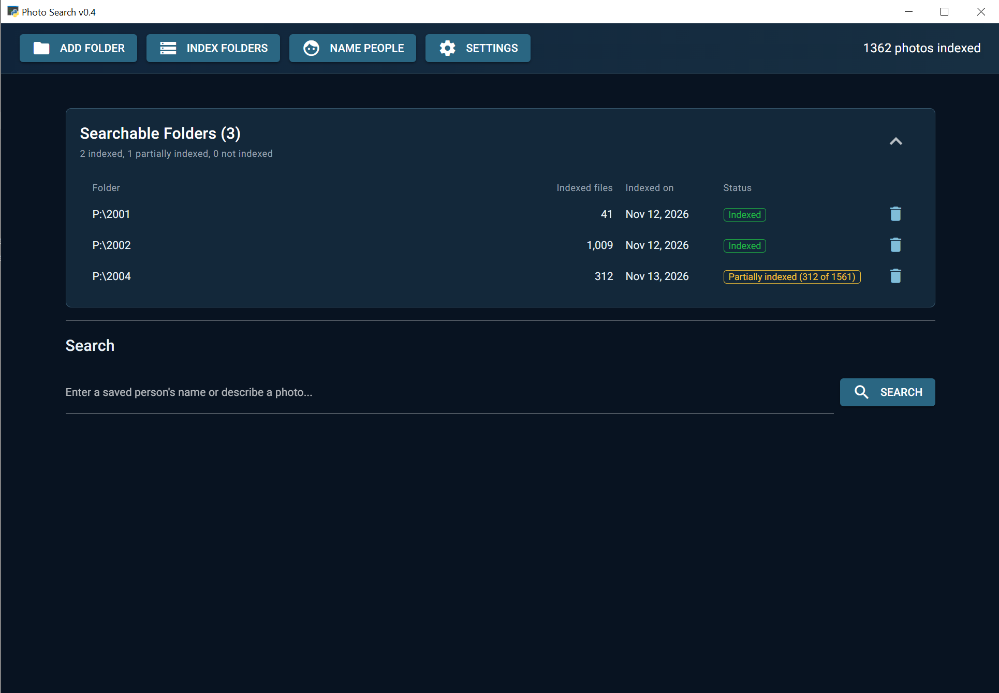
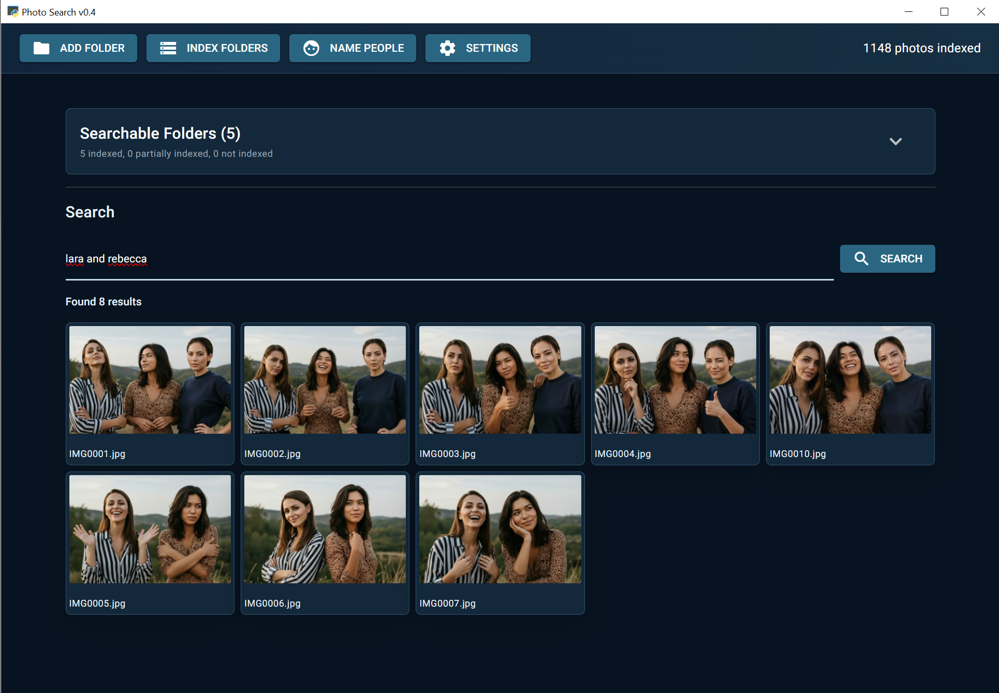
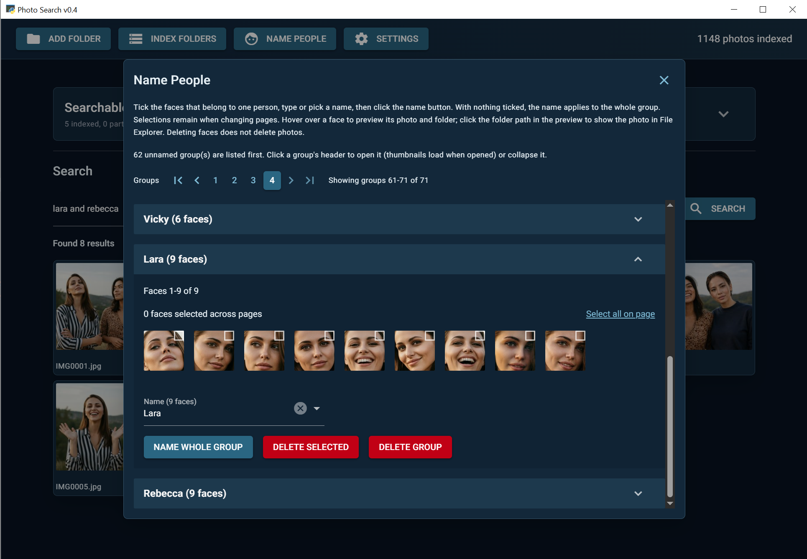

# Photo Search

Photo Search is a Windows desktop application for indexing and searching a personal photo library. It combines text-to-image search with face detection, clustering, and person naming.

## Features

- Add photo folders and index new or changed images, with progress and cancellation.
- The free version indexes up to 1,000 photos per index; existing indexed photos remain searchable at the limit.
- Search using a visual description, saved people's names, capture dates, or a combination.
- Group detected faces, name whole groups or selected faces, and merge matching names.
- Review paginated face groups, preview the original photo and its folder, and delete face detections without deleting photos.
- View paginated search results as thumbnails and open a larger, orientation-corrected preview.
- Configure face page size, initially expanded groups, and group-delete confirmations.

Face page size options are 30, 40, 50, or 60, with 30 as the default. Older saved values of 24, 32, and 48 are updated to 30, 30, and 50 respectively when Settings or Name People is opened.

## Screenshots

These screenshots use an isolated demonstration library with illustrated sample images.

### Main page

View searchable folders and their indexing status.



### Search results

Search for a description or a person's name and browse matching photos.



### Name People

The default view shows one representative face per group, with up to 40 groups
per page. Suggested names are filled in for review. Enter or choose a name and
press Enter or **Name** to name the whole group; focus moves to the group now in
the same position. Named people appear in a separate expandable section, where they
can be renamed or deleted. The representative is the largest detected face, not
necessarily the clearest one.

Use **Review faces** on a group or **Advanced** to inspect and select individual
faces. In the advanced view, name selected faces to move them to another person,
or name the whole group when none are selected. This also lets you split people
who were accidentally named together: select one person's faces and give them a
different name. Assigning an existing name merges faces into that named group.
Deleting a group or face detection does not delete the original photos.
**Delete All Unnamed Groups** removes unnamed groups and their face detections
after confirmation; named people and original photos are preserved.



When run from source, the application stores its SQLite index, settings, and generated thumbnails under `data/` in the project directory. Installed versions use `%LOCALAPPDATA%\Photo Search\data` by default. In **Settings > Data Storage**, type an existing folder path or select **Browse**, then select **Update** to use it. The chosen directory is remembered between runs, and its existing index and thumbnails are used without moving or copying data. An empty directory gets a new index; thumbnails are generated as needed. A damaged or incompatible database is left untouched and the change is rejected. Stop indexing and searches and close Name People before changing directories. Original photos remain in their selected folders. **Reset Index** in Settings deletes the active index contents, names, generated thumbnails, and settings; it does not delete the original photos or change the data directory.

## Windows installers

The CPU installer supports 64-bit Windows 10 version 1809 or later; Python is not required on the target PC. OpenCLIP, YuNet and SFace run on the CPU. Microsoft Edge WebView2 Runtime is required for the native window.

- [Download the CPU installer (v0.4)](https://pub-5c62851ff87d40acaeee8eb31d082ac7.r2.dev/v0.4/PhotoSearch-0.4-CPU-Setup.exe)

**The linked v0.4 installer predates the YuNet/SFace change and still uses InsightFace's non-commercial buffalo_l weights.** Build and publish a new installer before distributing the replacement.

New builds bundle the YuNet and SFace model weights and their license texts; they do not bundle a photo index, thumbnails, or OpenCLIP weights. OpenCLIP still downloads its model into the Hugging Face cache on first use. YuNet is MIT licensed and SFace is Apache 2.0 licensed; see `third_party_licenses` in the installed application.

When opening an older index, the app discards incompatible face detections and associations with names, marks photos and folders for re-indexing, and retains the photos, OpenCLIP embeddings, and folder settings. Select **Index Folders** to regenerate faces; review and assign names again. Original photos are not modified. Back up the data directory first if you need to preserve the old face assignments.

The installed app stores its data-directory selection and diagnostic log under `%LOCALAPPDATA%\Photo Search`. The log can contain local paths; review it before sharing. Uninstalling the application does not remove this directory, the model caches, or original photos. An existing source-run index is not automatically moved: select its data directory in Settings if you want to use it. Close any other running Photo Search edition before opening the app because they share the same data directory. The installer is unsigned, so Windows may display a publisher warning.

## Running from source

Source execution requires Windows, Python 3.10 or later, and the dependencies in `requirements.txt`.

From the project directory in PowerShell:

```powershell
python -m venv venv
.\venv\Scripts\python.exe -m pip install torch torchvision --index-url https://download.pytorch.org/whl/cpu
.\venv\Scripts\python.exe -m pip install -r requirements.txt
.\venv\Scripts\python.exe main.py
```

Model loading can take time on the first startup.
The first face indexing run downloads the pinned YuNet and SFace models into `models/` and verifies their SHA-256 hashes. Source runs need internet access for that initial download.

## Building Windows installers

Use 64-bit Python 3.13 and Inno Setup 7. From PowerShell in the project directory, create the CPU environment:

```powershell
py -3.13 -m venv .venv-cpu
.\.venv-cpu\Scripts\python.exe -m pip install torch==2.6.0+cpu torchvision==0.21.0+cpu --index-url https://download.pytorch.org/whl/cpu
.\.venv-cpu\Scripts\python.exe -m pip install -r packaging\requirements-windows.txt
.\.venv-cpu\Scripts\python.exe packaging\build_windows.py CPU --iscc "C:\path\to\ISCC.exe"
```

The build script requires CPU-only PyTorch, downloads and verifies the pinned face models if needed, bundles only those two model files, rejects bundled databases and other model weights, includes third-party notices, and writes installers to `dist\installers`. Code signing and publication are separate steps.

Windows builds use the Picture Search logo as the application, shortcut, taskbar,
and installer icon. Rebuild and reinstall to update an existing installation.

On startup, Photo Search checks the official downloads page for newer CPU R2
installers. If one is available, a link appears in the header; connection
failures do not display a message. The link opens
`https://www.snowfoxninja.com/#downloads` by default. To change its destination,
set `"download_url"` to an HTTPS URL in `.photo-search-config.json` when running
from source, or `%LOCALAPPDATA%\Photo Search\config.json` when installed. Other
settings in that file are preserved when changing the data directory.

## Using the application

1. Select **Add Folder** and choose one or more photo folders.
2. Select **Index Folders** to scan photos, create thumbnails, and detect and group faces.
3. Use **Name People** to review face groups and assign names. The same saved name can be used to merge groups.
4. Enter a description or a saved person's name in **Search**. Select a result to view a larger preview.
5. Use **Settings** to adjust face-group display and deletion behavior, or reset the index.

Search and face grouping are based on machine-learning models, so matches and group suggestions should be reviewed before naming or deleting detections.
In a search result's photo preview, select the folder path to open File Explorer with the original photo selected.
Search accepts a full saved name or an individual first, middle, or last name. A name part matches all saved people with that part; a full name is more specific. Ordinary search words such as "group" are not treated as partial names.
Search can also filter by capture date using prompts such as `John in 2026`, `Jane before Feb 2020`, `Lara last year`, or `Ming after 10/01/2013`. “Last year” means the previous calendar year. Numeric dates use month/day/year. Date filters use the photo's EXIF capture date; photos without that metadata are excluded from date-filtered results.
Unnamed groups appear first, with suggested matches at the top; within each set, groups with more faces appear first.
The **Indexed on** date is displayed in local time and changes only when a scan adds or updates a photo in that folder, including during a cancelled scan. Scans that skip all photos do not change the date.
Removing a searchable folder requires confirmation and removes its indexed photos, faces and generated thumbnails. Photos covered by another searchable folder remain indexed. Original files and saved people are not deleted.
By default, **Settings > Indexing > Skip Previously Indexed Folders** skips completed folders without checking for new or changed files. Turn it off to rescan those folders and detect changes or regenerate missing thumbnails. Interrupted or failed folders are scanned again. When selected folders overlap, a skipped folder is also excluded from its selected parent.

The free-version photo limit applies to the total number of photos in the active index, across
all folders. When the limit prevents new photos from being added, the app reports
it and leaves affected folders incomplete for a later scan. Previously indexed
photos remain available and can be updated, even if an existing index exceeds
the limit. Removing indexed photos frees space; original files are not deleted.
Developers can change `PHOTO_INDEX_LIMIT` in `core/scanner.py` before building.
Paid licenses are validated by the Photo Search licensing service at
`https://licensing.snowfoxninja.com`. Open **Settings > License**, enter a
license key, and select **Activate**. The app sends the key and a
persistent random machine ID to the validation endpoint; it does not send
photos or the photo index. A successful validation permanently unlocks that
device, even when it is offline. The app does not revalidate the activation, so
server-side revocation, deactivation, or later expiry will not relock an already
activated device. A fresh installation or another device without a copied
activation config must validate separately. Since the key and permanent
activation are stored in the local app configuration (the key is plaintext),
copying that config can copy the unlock too. Server activation limits and
revocation cannot prevent that or lock out an already activated copy. This
local state is not tamper-proof, so the client-side photo limit is not a
security boundary against a determined user. Resetting the photo index does
not remove the license configuration.

## Face pipeline benchmark

Run the standalone benchmark from the project directory with an existing CPU environment:

```powershell
.\venv-cpu\Scripts\python.exe tools\benchmark_faces.py --index data\photo_search.db --limit 30 --repeat 2 --warmup 2 --output face-benchmark-cpu.json
```

Alternatively, use `--directory C:\path\to\photos` instead of `--index`; the benchmark recursively selects supported images in sorted order. Index selection uses the first photo IDs and opens the database read-only. Missing images and face-processing errors fail the run rather than being counted as photos without faces. The benchmark does not modify the index.

Results contain image, model, and face-engine SHA-256 hashes, OpenCV runtime details, startup time, face counts, and per-image and aggregate timings. Compare runs only when their dataset fingerprints, image counts, and settings match; a changed index can change the sample. Results include hashes derived from personal photos and machine details, so review them before sharing.

Timings cover the current CPU YuNet + SFace `detect_faces` pipeline, including image decoding, detection and embeddings, but not CLIP, thumbnail generation, database writes, or the complete indexing workflow. Model loading is measured separately; hashing and warmup precede the timed runs, so these are warm-cache timings. Face counts are not an accuracy measure; evaluate recognition quality separately using a labeled photo set.

### YuNet and SFace

The separate OpenCV benchmark does not change the app. Download the [YuNet model](https://github.com/opencv/opencv_zoo/tree/48b10fa505aeb51fbd127fc60a5c660040e823b7/models/face_detection_yunet) and [SFace model](https://github.com/opencv/opencv_zoo/tree/48b10fa505aeb51fbd127fc60a5c660040e823b7/models/face_recognition_sface) from this pinned OpenCV Zoo revision. The models used for the baseline were `face_detection_yunet_2026may.onnx` (SHA-256 `ebafce4e3c118d6554634be5c27ab333b4c047a9a8c3faf1d7cf93101c22f0f0`) and `face_recognition_sface_2021dec.onnx` (SHA-256 `0ba9fbfa01b5270c96627c4ef784da859931e02f04419c829e83484087c34e79`). Verify the downloaded files with `Get-FileHash` before running:

```powershell
.\venv-cpu\Scripts\python.exe tools\benchmark_opencv_faces.py --index data\photo_search.db --yunet C:\path\to\face_detection_yunet_2026may.onnx --sface C:\path\to\face_recognition_sface_2021dec.onnx --limit 30 --repeat 2 --warmup 2 --output opencv-full.json
.\venv-cpu\Scripts\python.exe tools\benchmark_opencv_faces.py --index data\photo_search.db --yunet C:\path\to\face_detection_yunet_2026may.onnx --sface C:\path\to\face_recognition_sface_2021dec.onnx --limit 30 --repeat 2 --warmup 2 --max-dimension 640 --output opencv-640.json
```

Both request OpenCV's CPU backend, disable OpenCL, and require OpenCV's `FaceDetectorYN` and `FaceRecognizerSF` APIs. The full-resolution run matches the earlier OpenCV configuration; the 640-pixel variant resizes for detection and maps landmarks back to the original image for SFace alignment. Both decode with the app's EXIF-aware Pillow pipeline. OpenCV 5's new graph engine may warn that it ignores the requested target; inspect the installed build before assuming which device is used. Resizing and different detector thresholds affect which faces are found, so speed and face-count comparisons alone do not establish accuracy.

For YuNet + SFace, pass `--score-threshold 0.7` to compare a lower detection threshold; the default is 0.8.

### YuNet and AuraFace

This optional historical benchmark requires separately installing InsightFace and ONNX Runtime in a separate environment; neither is needed by the app. It uses YuNet but computes embeddings with AuraFace. Download only [`glintr100.onnx` from AuraFace-v1](https://huggingface.co/fal/AuraFace-v1/blob/94ee6ceb788a98a88807db884ae1f00d7e070d23/glintr100.onnx); the benchmarked file's SHA-256 is `a7933ea5330113b01c9b60351d8f4c33003f145d8470ac5f0e52ee2effe25c60`. Review the model's provenance and commercial-use terms separately before distributing it.

```powershell
.\venv-cpu\Scripts\python.exe tools\benchmark_auraface.py --index data\photo_search.db --yunet C:\path\to\face_detection_yunet_2026may.onnx --auraface C:\path\to\glintr100.onnx --provider CPUExecutionProvider --limit 30 --repeat 2 --warmup 2 --output auraface-cpu.json
```

Add `--max-dimension 640` to benchmark resized detection. YuNet and AuraFace run on CPU; the benchmark fails if the CPU provider is unavailable or not first in its session. The output records both model hashes and the recognition session providers.

## Tests

Run the unit tests from the project directory:

```powershell
.\venv\Scripts\python.exe -m unittest discover -s tests
```

## Project layout

- `main.py` — desktop interface and application workflow.
- `core/` — database, indexing, search, face processing, previews, and startup.
- `tests/` — unit and UI workflow tests.
- `tools/extract_faces.py` — regenerate missing face thumbnails from the local index.
- `tools/benchmark_faces.py`, `tools/benchmark_opencv_faces.py`, `tools/benchmark_auraface.py` — compare face-processing pipelines.

The `data/` directory, virtual environment, and other local generated files are excluded from version control.
