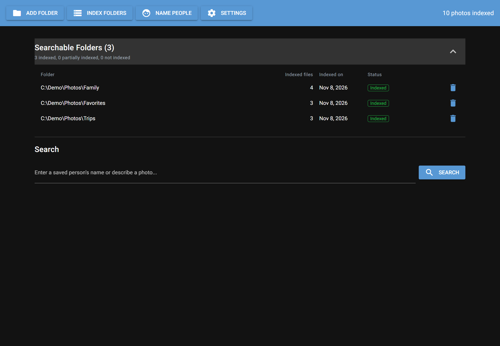
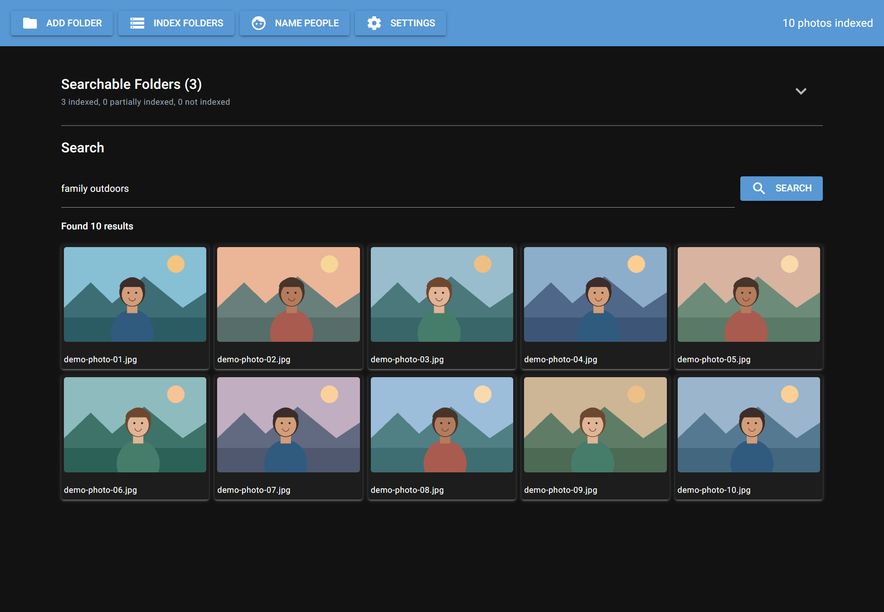
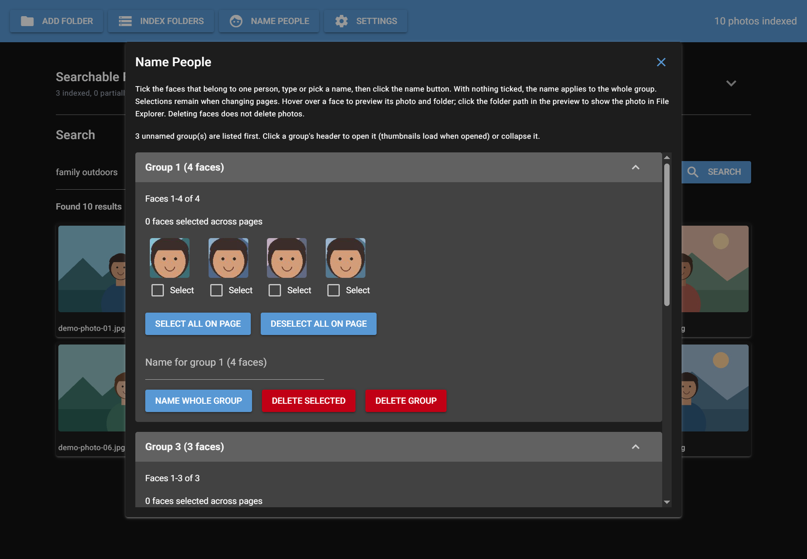

# Photo Search

Photo Search is a Windows desktop application for indexing and searching a personal photo library. It combines text-to-image search with face detection, clustering, and person naming.

## Features

- Add photo folders and index new or changed images, with progress and cancellation.
- Search using a visual description, saved people's names, or a combination of both.
- Group detected faces, name whole groups or selected faces, and merge matching names.
- Review paginated face groups, preview the original photo and its folder, and delete face detections without deleting photos.
- View paginated search results as thumbnails and open a larger, orientation-corrected preview.
- Configure face page size, initially expanded groups, and group-delete confirmations.

## Screenshots

These screenshots use an isolated demonstration library with illustrated sample images.

### Main page

View searchable folders and their indexing status.



### Search results

Search for a description or a person's name and browse matching photos.



### Name People

Review detected face groups and assign names.



By default, the application stores its SQLite index, settings, and generated thumbnails under `data/` in the project directory. In **Settings > Data Storage**, type an existing folder path or select **Browse**, then select **Update** to use it. The chosen directory is remembered between runs, and its existing index and thumbnails are used without moving or copying data. An empty directory gets a new index; thumbnails are generated as needed. A damaged or incompatible database is left untouched and the change is rejected. Stop indexing and searches and close Name People before changing directories. Original photos remain in their selected folders. **Reset Index** in Settings deletes the active index contents, names, generated thumbnails, and settings; it does not delete the original photos or change the data directory.

## Requirements

- Windows and Python 3.10 or later.
- Dependencies listed in `requirements.txt`.
- A compatible NVIDIA GPU and CUDA/cuDNN setup are recommended for accelerated indexing. CPU execution may be slower. The included `onnxruntime-gpu` dependency also requires a compatible runtime setup.
- Internet access may be required the first time model weights are downloaded by OpenCLIP and InsightFace.

## Installation and startup

From the project directory in PowerShell:

```powershell
python -m venv venv
.\venv\Scripts\python.exe -m pip install -r requirements.txt
.\venv\Scripts\python.exe main.py
```

For GPU acceleration, install a PyTorch build compatible with your CUDA setup if the default installation does not provide one. Model loading can take time on the first startup.

## Using the application

1. Select **Add Folder** and choose one or more photo folders.
2. Select **Index Folders** to scan photos, create thumbnails, and detect and group faces.
3. Use **Name People** to review face groups and assign names. The same saved name can be used to merge groups.
4. Enter a description or a saved person's name in **Search**. Select a result to view a larger preview.
5. Use **Settings** to adjust face-group display and deletion behavior, or reset the index.

Search and face grouping are based on machine-learning models, so matches and group suggestions should be reviewed before naming or deleting detections.
In a search result's photo preview, select the folder path to open File Explorer with the original photo selected.
Search accepts a full saved name or an individual first, middle, or last name. A name part matches all saved people with that part; a full name is more specific. Ordinary search words such as "group" are not treated as partial names.
Unnamed groups appear first, with suggested matches at the top; within each set, groups with more faces appear first.
The **Indexed on** date is displayed in local time and changes only when a scan adds or updates a photo in that folder, including during a cancelled scan. Scans that skip all photos do not change the date.
Removing a searchable folder requires confirmation and removes its indexed photos, faces and generated thumbnails. Photos covered by another searchable folder remain indexed. Original files and saved people are not deleted.
By default, **Settings > Indexing > Skip Previously Indexed Folders** skips completed folders without checking for new or changed files. Turn it off to rescan those folders and detect changes or regenerate missing thumbnails. Interrupted or failed folders are scanned again. When selected folders overlap, a skipped folder is also excluded from its selected parent.

## Tests

Run the unit tests from the project directory:

```powershell
.\venv\Scripts\python.exe -m unittest discover -s tests
```

## Project layout

- `main.py` — desktop interface and application workflow.
- `core/` — database, indexing, search, face processing, previews, and startup.
- `tests/` — unit and UI workflow tests.
- `tools/extract_faces.py` — regenerate missing face thumbnails from the local index.

The `data/` directory, virtual environment, and other local generated files are excluded from version control.
